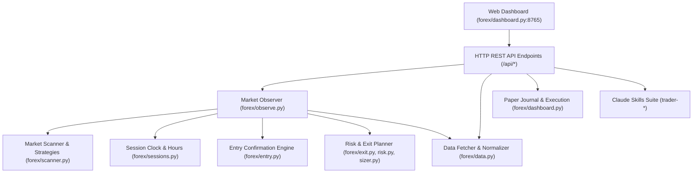

# Architecture

## System Overview

The Day Trader Skill & Forex Paper Trading Platform is structured into two main operational pillars:

## Component Roles

1. **`forex/dashboard.py`**:
   - HTTP server hosting single-page dashboard application.
   - Handles REST API requests (`/api/pairs`, `/api/observe`, `/api/chart`, `/api/backtest`, `/api/paper/*`, `/api/config`, `/api/calibrate`).
   - Maintains in-memory paper trading state and live ticks.
2. **`forex/data.py`**:
   - Multi-source price fetcher: Twelve Data, Yahoo Finance, Binance PAXG proxy.
   - Robust fallback and retry logic.
3. **`forex/sessions.py`**:
   - Wall-clock session engine with daylight saving time calculations (London, New York, Tokyo, Sydney).
   - Market open/closed assertions for Spot Forex and COMEX Gold Futures.
4. **`forex/scanner.py` & `forex/entry.py`**:
   - Rule-based setup detection (Asian breakout, moving average trends, RSI).
   - Candle-close confirmation rules (ignoring mere wicks).
5. **`forex/exit.py` & `forex/sizer.py` & `forex/risk.py`**:
   - 2R risk-to-reward exit planning, lot sizing based on max USD loss limits, risk limits verification.
6. **`trader-*` modules**:
   - Standalone CLI skills designed for US equity markets, SEC disclosures, Congressional disclosures.
